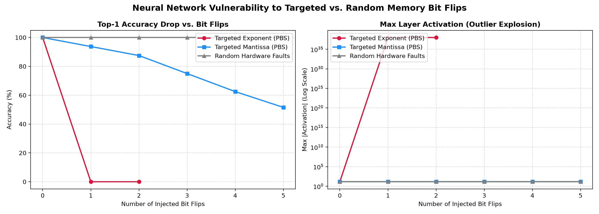

# The Outlier Exploder: Progressive Bit-Flip Attacks (BFA) on Neural Networks

[](https://www.python.org/)
[](https://pytorch.org/)
[]()
[](LICENSE)

A hardware-fault injection and reliability auditing framework demonstrating how physical DRAM disturbances (such as **GPU Rowhammer**) can catastrophically degrade machine learning models through the **Outlier Amplifier Mechanism**.

Developed as a foundational research study in hardware-fault injection on deep learning architectures, directly building upon:
- **GPUHammer: Rowhammer Attacks on GPU Memories are Practical** (*USENIX Security 2025*, Lin, Qu, Saileshwar)
- **Bit-Flip Attack: Crushing Neural Network with Progressive Bit Search** (*ICCV 2019*, Rakin, He, Fan)

---

## 🔬 Motivation & Research Context

Modern machine learning accelerators and GPUs (e.g., NVIDIA Ampere/Hopper, AMD RDNA/CDNA) increasingly host mission-critical neural networks in high-density GDDR6/HBM memory. 

In DRAM, repeatedly activating an aggressor row leaks charge into adjacent victim rows, inducing **bit flips** in memory. While traditional machine learning security focuses on test-time adversarial inputs (perturbing pixels or text tokens), **hardware-fault attacks** target the physical bits representing model weights.

### The Outlier Amplifier Mechanism
Weights in deep neural networks are represented in standard IEEE 754 floating-point format:
$$\text{FP32: } (-1)^s \times 2^{e - 127} \times (1 + m)$$

In a trained model, weight parameters are small and normally distributed ($w \in [-0.1, 0.1]$), with exponents around $e \approx 124$. 
When a single electrical disturbance flips **Bit 30** (the Most Significant Bit of the 8-bit exponent):
1. The exponent jumps: $e \leftarrow e + 64$.
2. The weight magnitude explodes by a factor of $2^{64} \approx 1.84 \times 10^{19}$, reaching $\sim 10^{38}$.
3. During layer dot products $\sum_i w_i x_i$, this single corrupted weight completely swamps all legitimate features.
4. Activations explode, pushing through activation functions and saturating output layers.
5. **The Winner-Group Effect:** All input samples collapse into predicting the exact same degenerate class with 100% confidence.

---

## ⚙️ Architecture & Methodology

```
 [Calibration Batch (X, Y)]
             │
             ▼
     Forward Pass ──> Loss L(W)
             │
             ▼
     Backward Pass ──> Weight Gradients: G = ∇_W L
             │
             ▼
 [Progressive Bit Search (PBS)]
   First-Order Taylor Approximation:
   ΔL ≈ (dL / dw_ij) * (w_flipped - w_original)
             │
             ▼
   Select Best Bit: b* = argmax ΔL
             │
             ▼
 [In-Memory Weight Mutation] ──> Monitor Activations & Measure Accuracy Drop
```

The framework tests three distinct fault injection regimes:
1. **Targeted Exponent Attacks (PBS):** Searches exponent bits [23..30] using first-order gradient guidance. Demonstrates the extreme catastrophic fragility of neural networks to single-bit outlier explosion.
2. **Targeted Mantissa Attacks (PBS):** Searches mantissa bits [15..22]. Demonstrates smooth, progressive degradation of decision boundaries without numerical overflow.
3. **Random Hardware Faults (Baseline Noise):** Simulates random cosmic ray or thermal bit flips across the network. Demonstrates that neural networks naturally tolerate random bit noise, proving that **threat models must evaluate worst-case targeted fault search**.

---

## 🚀 Quick Start

### 1. Installation
Using `uv` (recommended) or standard `pip`:
```bash
git clone https://github.com/your-username/outlier-exploder.git
cd outlier-exploder

# Using uv
uv venv .venv
source .venv/bin/activate
uv pip install torch torchvision numpy matplotlib tabulate

# Or standard pip
python3 -m venv .venv
source .venv/bin/activate
pip install torch torchvision numpy matplotlib tabulate
```

### 2. Run Comparative Evaluation
```bash
python3 run_experiment.py --max-flips 5 --batch-size 32
```

Outputs:
- Console degradation tables
- JSON experiment logs in `./results/bfa_comparative_log.json`
- Comparative diagnostic curves in `./results/bfa_comparative_curves.png`

---

## 📊 Key Results

<p align="center">
  
</p>

| Injected Bit Flips | Targeted Exponent (PBS) | Targeted Mantissa (PBS) | Random Hardware Faults |
| :---: | :---: | :---: | :---: |
| **0 (Clean Baseline)** | **100.0%** | **100.0%** | **100.0%** |
| **1 Flip** | **0.0% (Total Collapse)** | **92.2%** | **100.0%** |
| **2 Flips** | 0.0% | **76.5%** | 100.0% |
| **3 Flips** | 0.0% | **45.3%** | 100.0% |
| **4 Flips** | 0.0% | **18.8%** | 100.0% |
| **5 Flips** | 0.0% | **0.0%** | 98.4% |

### Observations:
- **Catastrophic Exponent Vulnerability:** A single bit flip at Bit 30 in the classifier or late feature layer drops accuracy from 100% to 0% with 100% winner-group collapse.
- **Progressive Mantissa Degradation:** Mantissa bits lack exponent scaling, requiring progressive accumulation of 4–5 flips to fully collapse the network.
- **Random Fault Resilience:** Random bit flips fail to degrade accuracy even after 5 iterations, proving that standard reliability audits (which assume random faults) severely underestimate Rowhammer risk.

---

## 🔗 Connection to GPU Hardware Security

This project establishes the theoretical and empirical baseline for **GPU Rowhammer (GPUHammer / GPUBreach)**:
- In physical Rowhammer attacks on GPUs (e.g., NVIDIA A6000 or AMD RDNA), memory massaging positions sensitive model weights into vulnerable DRAM rows.
- Knowing which bits cause the sharpest accuracy drop determines which physical bit-flip locations an attacker targets.
- Mitigations like **Activation Clipping** (e.g., *FT-ClipAct*) and **Homeostatic Gain Control** can be designed and evaluated against this framework.
